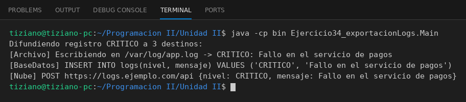

# DestinoLog

Programación II - Unidad 2 - Ejercicio 34

## Consigna
Un gestor de auditoría difunde registros de eventos a varios destinos de almacenamiento.

## Lógica
- Interfaz `DestinoLog` con `guardarRegistro(nivel, mensaje)`.
- `LogArchivoLocal`, `LogBaseDatos` y `LogServicioNube` simulan cada protocolo.
- `GestorAuditoria` guarda una lista de destinos y difunde el registro a todos.
- `Main`: un registro CRITICO enviado a los tres destinos.

## Ejecución

